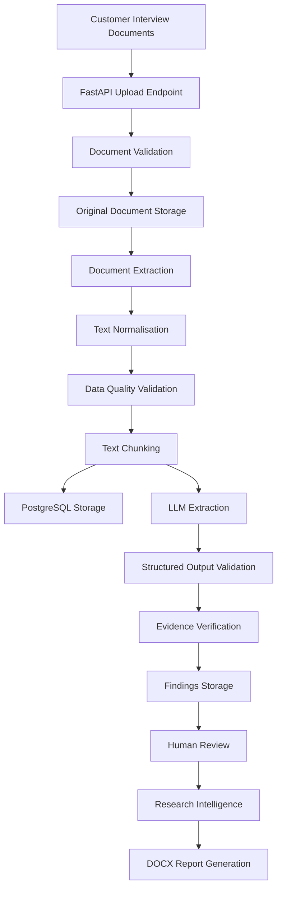
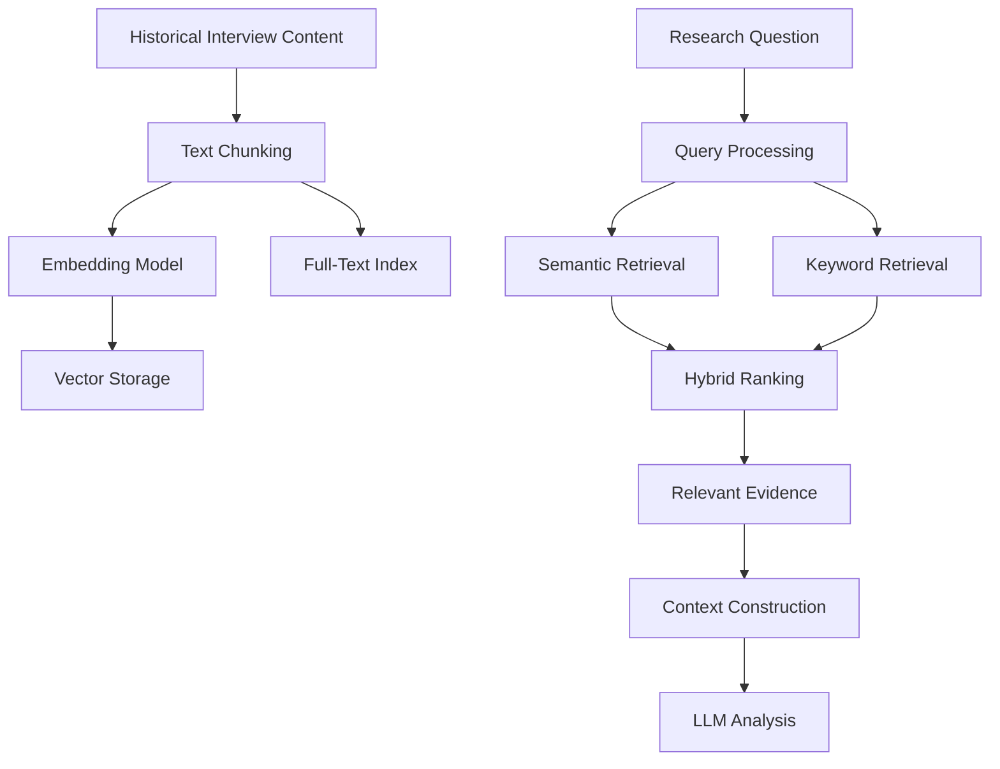
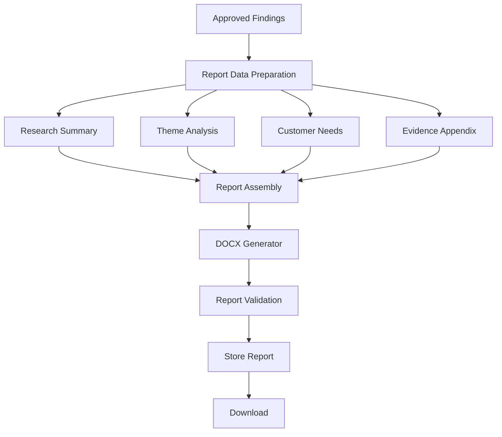

# Customer Discovery Intelligence System (CDIS)
## System Architecture Document

**Document:** `architecture.md`  
**Project:** Customer Discovery Intelligence System (CDIS)  
**Version:** 1.0  
**Date:** November 2026  
**Status:** Initial architecture specification

---

# 1. Introduction

## 1.1 Purpose

This document describes the technical architecture of the Customer Discovery Intelligence System (CDIS).

It defines:

- The overall system architecture.
- Major application components.
- Responsibilities of individual modules.
- Technology choices.
- Data flow between components.
- Integration patterns.
- Storage architecture.
- AI and retrieval architecture.
- Workflow orchestration.
- Deployment architecture.
- Security and reliability considerations.
- Architectural decisions and future evolution.

The document serves as the technical reference for implementation.

## 1.2 System Vision

CDIS is an AI-powered research intelligence platform that transforms unstructured customer discovery materials into structured, evidence-backed and actionable product intelligence.

The system should allow users to upload customer interviews and other research materials, automatically process them, identify meaningful customer insights, discover patterns across interviews, and generate structured research reports.

The central architectural challenge is not simply generating text using an LLM.

It is designing a reliable pipeline that can:

1. Ingest different document formats.
2. Extract and preserve source content.
3. Validate the quality of extracted information.
4. Identify meaningful customer insights.
5. Associate every finding with supporting evidence.
6. Analyse information across multiple interviews.
7. Preserve research history.
8. Support human review.
9. Generate reliable reports.

## 1.3 Core Architectural Principle

**Every customer insight must remain traceable to its original source evidence.**

CDIS must distinguish between:

| Concept | Meaning |
|---|---|
| Evidence | What the customer actually said |
| Interpretation | What the system believes the statement means |
| Recommendation | What the organisation could consider doing |

An AI-generated interpretation must never be presented as a verified customer statement.

The system should also preserve uncertainty. When the evidence is insufficient, it should be able to report that limitation rather than inventing a conclusion.

---

# 2. Architectural Overview

## 2.1 Architectural Style

CDIS will initially use a **modular monolithic architecture**.

A modular monolith is a single deployable application whose internal components are separated into clearly defined modules with specific responsibilities.

The application will use:

- One Python monorepository.
- One FastAPI backend.
- One Streamlit frontend.
- One PostgreSQL database.
- A modular document-processing pipeline.
- A modular AI intelligence layer.
- A workflow orchestration layer.

The modules will communicate through explicit interfaces rather than accessing each other's internal implementation indiscriminately.

## 2.2 Why a Modular Monolith?

A modular monolith is appropriate because:

1. The project is initially developed by a small engineering team.
2. The application has closely related business capabilities.
3. The initial workload does not justify distributed services.
4. A single codebase simplifies testing and debugging.
5. Deployment is easier than managing multiple independent services.
6. Modules can be extracted into separate services later if justified.

The objective is to establish good software boundaries without introducing unnecessary infrastructure.

## 2.3 High-Level Architecture

The system consists of the following logical layers:

| Layer | Responsibility | Main technologies |
|---|---|---|
| Presentation | User interaction | Streamlit |
| API | HTTP communication and request handling | FastAPI |
| Application | Business operations and coordination | Python services |
| Document engineering | Ingestion, extraction and validation | python-docx, pypdf |
| Intelligence | LLM extraction and research analysis | Ollama, Sentence Transformers |
| Retrieval | Semantic, lexical and hybrid search | PostgreSQL, pgvector |
| Persistence | Structured and file metadata storage | PostgreSQL, SQLAlchemy |
| Workflow | Multi-stage processing | Python, LangGraph |
| Reporting | Research report generation | python-docx |
| Evaluation | AI quality measurement | Python, MLflow |
| Observability | Application and LLM monitoring | Logging, Langfuse |
| Infrastructure | Packaging and deployment | Docker, GitHub Actions, Google Cloud |

---

# 3. Logical System Architecture

## 3.1 Main Components

CDIS will be organised around the following components:

### 1. Presentation Layer

Provides the user interface.

Responsibilities:

- Project management.
- Document uploads.
- Processing status.
- Research findings.
- Human review.
- Report generation.
- Report downloads.

Technology: Streamlit.

### 2. API Layer

Provides the application interface to the frontend and other permitted clients.

Responsibilities:

- Receive HTTP requests.
- Validate incoming requests.
- Authenticate and authorise users when implemented.
- Invoke application services.
- Return structured responses.
- Handle API errors.

Technology: FastAPI.

### 3. Application Layer

Coordinates business operations.

Responsibilities:

- Create research projects.
- Manage documents.
- Initiate processing.
- Retrieve findings.
- Manage review operations.
- Request report generation.

Technology: Python service modules.

### 4. Document Engineering Layer

Responsible for transforming source documents into usable, structured text.

Responsibilities:

- File validation.
- Document parsing.
- Content extraction.
- Text normalisation.
- Structural preservation.
- Chunking.
- Data quality checks.
- Duplicate detection.

Technologies: Python, python-docx, pypdf.

### 5. Intelligence Layer

Responsible for interpreting research content.

Responsibilities:

- Customer problem extraction.
- Customer need extraction.
- Feature request extraction.
- Evidence identification.
- Theme analysis.
- Contradiction detection.
- Research synthesis.

Technologies: Ollama, open-weight LLMs, Python and Pydantic.

### 6. Retrieval Layer

Provides access to relevant historical research.

Responsibilities:

- Embedding generation.
- Vector storage.
- Keyword retrieval.
- Semantic retrieval.
- Hybrid retrieval.
- Context preparation.

Technologies: Sentence Transformers, PostgreSQL full-text search and pgvector.

### 7. Persistence Layer

Manages structured application information.

Responsibilities:

- Research project storage.
- Document metadata.
- Extracted content references.
- Findings.
- Evidence.
- Processing history.
- Review history.
- Report metadata.

Technologies: PostgreSQL and SQLAlchemy.

### 8. Workflow Layer

Coordinates multi-stage processing.

Responsibilities:

- Execute processing stages.
- Maintain workflow state.
- Manage conditional execution.
- Handle failures.
- Support retries.
- Preserve checkpoints.
- Request human approval.

Technologies: Python initially, LangGraph later.

### 9. Reporting Layer

Transforms approved research intelligence into downloadable documents.

Responsibilities:

- Assemble report data.
- Generate report sections.
- Format evidence references.
- Generate DOCX documents.
- Validate generated reports.

Technology: python-docx.

### 10. Evaluation and Observability Layer

Measures system performance and provides operational visibility.

Responsibilities:

- Evaluate extraction quality.
- Evaluate retrieval quality.
- Measure evidence grounding.
- Track experiments.
- Monitor LLM execution.
- Record failures and latency.

Technologies: pytest, MLflow, Langfuse and structured logging.

---

# 4. Application Architecture

## 4.1 Repository Structure

The following is the intended long-term structure.

Directories will be introduced progressively rather than created all at once.

```text
customer-discovery-intelligence/
│
├── frontend/
│   ├── app.py
│   ├── pages/
│   │   ├── dashboard.py
│   │   ├── projects.py
│   │   ├── documents.py
│   │   ├── findings.py
│   │   └── reports.py
│   │
│   └── components/
│
├── backend/
│   └── app/
│       ├── main.py
│       │
│       ├── api/
│       │   ├── routes/
│       │   └── dependencies.py
│       │
│       ├── core/
│       │   ├── config.py
│       │   ├── logging.py
│       │   └── security.py
│       │
│       ├── schemas/
│       │
│       ├── models/
│       │
│       ├── repositories/
│       │
│       ├── services/
│       │
│       ├── ingestion/
│       │   ├── parser.py
│       │   ├── extractor.py
│       │   ├── cleaner.py
│       │   ├── validator.py
│       │   └── chunker.py
│       │
│       ├── intelligence/
│       │   ├── llm.py
│       │   ├── embeddings.py
│       │   ├── extraction.py
│       │   ├── retrieval.py
│       │   └── analysis.py
│       │
│       ├── workflows/
│       │   ├── state.py
│       │   ├── research_workflow.py
│       │   └── nodes/
│       │
│       ├── evaluation/
│       │
│       ├── reporting/
│       │   ├── generator.py
│       │   └── templates/
│       │
│       └── database/
│           ├── connection.py
│           └── migrations/
│
├── tests/
│   ├── unit/
│   ├── integration/
│   └── evaluation/
│
├── data/
│   ├── sample_documents/
│   └── evaluation_dataset/
│
├── docs/
│   ├── architecture.md
│   ├── database_design.md
│   ├── api_contract.md
│   ├── development_roadmap.md
│   └── decisions/
│
├── scripts/
│
├── .github/
│   └── workflows/
│
├── .env.example
├── .gitignore
├── .dockerignore
├── Dockerfile
├── docker-compose.yml
├── pyproject.toml
├── uv.lock
└── README.md
```

## 4.2 Responsibilities of Important Directories

| Directory | Responsibility |
|---|---|
| `frontend/` | Streamlit application |
| `api/` | HTTP endpoints |
| `core/` | Configuration, logging and shared application concerns |
| `schemas/` | Pydantic request and response models |
| `models/` | SQLAlchemy database models |
| `repositories/` | Database access operations |
| `services/` | Business logic and application coordination |
| `ingestion/` | Document processing |
| `intelligence/` | LLM, embedding and analysis functions |
| `workflows/` | Processing orchestration |
| `evaluation/` | AI quality evaluation |
| `reporting/` | DOCX report generation |
| `database/` | Database connection and migration configuration |
| `tests/` | Automated tests |
| `docs/` | Technical documentation |
| `scripts/` | Development and maintenance scripts |

## 4.3 Important Architectural Distinctions

The following directories have different responsibilities and should not be treated as interchangeable.

### Schemas versus Models

`schemas/` contains Pydantic models used to validate and structure application inputs and outputs.

`models/` contains SQLAlchemy models that represent database tables.

For example:

- `schemas/document.py`: validates an uploaded document's metadata.
- `models/document.py`: defines how document metadata is stored in PostgreSQL.

### Repositories versus Services

Repositories handle database operations.

Services coordinate business rules and application functionality.

For example:

- `repositories/document_repository.py`: retrieves and saves document records.
- `services/document_service.py`: coordinates document upload, validation and processing.

### Services versus Workflows

Services implement individual business operations.

Workflows coordinate several operations into a larger process.

For example:

- A document service handles document registration.
- A research workflow coordinates registration, extraction, AI analysis and evidence validation.

### Intelligence versus Ingestion

Ingestion prepares reliable text and metadata.

Intelligence interprets that prepared information.

The LLM should not be responsible for basic file validation, document parsing or predictable text transformations.

---

# 5. End-to-End Data Flow

This section describes how information moves through CDIS.

## 5.1 Primary Research Processing Flow

The main processing sequence is:

1. A user creates a research project.
2. The user uploads an interview document.
3. FastAPI receives the document.
4. The document validator checks the upload.
5. The original document is preserved.
6. The extraction component extracts paragraphs, headings and tables.
7. Extracted content is normalised.
8. Data quality checks are performed.
9. Content is divided into meaningful chunks.
10. The processed content and metadata are stored.
11. The intelligence layer sends relevant content to the LLM.
12. The LLM identifies customer problems, needs and feature requests.
13. Structured responses are validated with Pydantic.
14. Supporting quotations are checked against source content.
15. Validated findings are stored.
16. Findings become available for human review.
17. Approved findings become available for research synthesis and reporting.

## 5.2 Data Flow Representation



The workflow should also record processing failures and the stage at which they occur.

## 5.3 Data Preservation Strategy

CDIS must preserve different representations of the same document.

| Representation | Purpose |
|---|---|
| Original file | Preserve the original source |
| Extracted raw text | Preserve parser output |
| Normalised text | Provide consistent text for downstream processing |
| Document sections | Preserve meaningful structure |
| Chunks | Support targeted AI processing and retrieval |
| Extracted findings | Store structured intelligence |
| Evidence records | Preserve the connection between findings and source material |

Do not overwrite the original source document when normalising text.

---

# 6. Document Engineering Architecture

## 6.1 Document Processing Pipeline

The document engineering layer will be implemented as a sequence of specialised components.

### Component 1: File Validator

Checks whether the uploaded file can safely and correctly be processed.

Responsibilities:

- Extension validation.
- File size validation.
- Format validation.
- Readability checks.
- Duplicate detection.

### Component 2: Document Parser

Identifies the document format and selects an appropriate parser.

Examples:

- DOCX parser.
- PDF parser.
- TXT parser.

### Component 3: Content Extractor

Extracts:

- Paragraphs.
- Headings.
- Tables.
- Speaker labels.
- Document metadata where available.

### Component 4: Text Cleaner

Performs controlled normalisation.

Examples:

- Whitespace normalisation.
- Unnecessary line-break handling.
- Formatting artefact removal.
- Speaker label normalisation.

### Component 5: Data Quality Validator

Checks whether the extracted content satisfies minimum quality requirements.

### Component 6: Chunker

Divides the document into manageable sections while preserving source references.

## 6.2 Data Quality Dimensions

| Dimension | Example check |
|---|---|
| Completeness | Does the transcript contain meaningful content? |
| Validity | Is the document a supported format? |
| Consistency | Are speaker labels represented consistently? |
| Uniqueness | Has the same document already been uploaded? |
| Accuracy | Does extracted text match the source? |
| Timeliness | Is the document's research date preserved? |
| Integrity | Can a finding be traced to its source? |

Data quality checks should produce explicit results rather than silently modifying problematic information.

---

# 7. Intelligence Architecture

## 7.1 Intelligence Processing

The intelligence layer interprets prepared interview content.

It is responsible for identifying:

- Customer problems.
- Customer needs.
- Feature requests.
- Supporting evidence.
- Recurring themes.
- Contradictory perspectives.
- Potential product opportunities.

## 7.2 LLM Integration

Ollama will initially provide local model inference.

The application should communicate with the model through a dedicated interface.

For example:

```text
Intelligence Service
        |
        v
LLM Interface
        |
        v
Ollama Adapter
        |
        v
Local Model
```

This separation makes it possible to change the model runtime or provider without rewriting the entire application.

## 7.3 Structured Extraction

LLM outputs should be converted into structured application data.

Example conceptual output:

```json
{
  "finding_type": "customer_problem",
  "description": "Customers struggle to track order progress.",
  "evidence": [
    {
      "quote": "I never know when my order will arrive.",
      "source_document_id": "document-001",
      "source_location": "paragraph-18"
    }
  ],
  "interpretation": "Customers lack visibility into order status.",
  "confidence": "medium"
}
```

This is an illustrative representation, not a final API or database schema.

## 7.4 Evidence Verification

Evidence verification is a critical control.

The system should check:

1. Whether the quotation exists in the original source.
2. Whether the source document is correct.
3. Whether the location reference is valid.
4. Whether the extracted finding is supported by the quotation.
5. Whether the model has introduced unsupported details.

A quotation that cannot be verified must be flagged rather than silently accepted.

## 7.5 Model Independence

Avoid hard-coding a particular model throughout the application.

A dedicated LLM interface should allow:

- Model selection.
- Model configuration.
- Prompt versioning.
- Timeout management.
- Error handling.
- Model metadata recording.

Model selection should be supported by evaluation rather than assumption.

---

# 8. Retrieval and RAG Architecture

## 8.1 Purpose

Retrieval-Augmented Generation allows CDIS to use historical research when analysing new customer interviews.

Instead of relying exclusively on the current document, the system can retrieve relevant information from previous research.

## 8.2 Retrieval Components

| Component | Responsibility |
|---|---|
| Chunker | Divides research content |
| Embedding model | Converts text into vectors |
| Vector storage | Stores embeddings |
| Full-text index | Supports keyword retrieval |
| Retrieval service | Retrieves relevant passages |
| Ranking component | Orders relevant results |
| Context builder | Prepares evidence for LLM analysis |

## 8.3 Retrieval Flow



## 8.4 Initial Technology Choice

PostgreSQL with pgvector will be used for vector storage.

PostgreSQL full-text search will support lexical retrieval.

This provides a practical starting point without introducing another database service.

## 8.5 Retrieval Evaluation

Retrieval quality must be evaluated using manually identified relevant passages.

Useful metrics include:

- Precision@K.
- Recall@K.
- Mean Reciprocal Rank.
- Normalised Discounted Cumulative Gain.

The system should prioritise retrieving relevant evidence over simply retrieving a large amount of context.

---

# 9. Workflow Architecture

## 9.1 Purpose

The workflow layer coordinates the full research processing lifecycle.

It should make execution state, dependencies, failures and recovery behaviour explicit.

## 9.2 Initial Workflow

Initially, workflows will be implemented using ordinary Python functions.

Conceptually:

```text
Research Workflow
       |
       v
Validate Document
       |
       v
Extract Content
       |
       v
Validate Content
       |
       v
Create Chunks
       |
       v
Extract Customer Insights
       |
       v
Verify Evidence
       |
       v
Save Findings
       |
       v
Complete Processing
```

## 9.3 Advanced Workflow

LangGraph will be introduced when the application needs more sophisticated stateful execution.

Potential capabilities:

- Conditional execution.
- Checkpointing.
- Human approval.
- Retry and recovery.
- Multiple analysis stages.
- Persistent workflow state.

## 9.4 Workflow Reliability

The workflow layer must account for:

- LLM timeouts.
- Invalid model responses.
- Database failures.
- Interrupted processing.
- Duplicate execution.
- Partial completion.
- Retry safety.

Processing a document twice should not accidentally create duplicate findings or inconsistent records.

---

# 10. Database and Persistence Architecture

## 10.1 Primary Database

PostgreSQL will serve as the main structured data store.

It will hold:

- User and project metadata.
- Document metadata.
- Interview records.
- Processing history.
- Findings.
- Evidence.
- Research themes.
- Review history.
- Report metadata.
- Vector embeddings.

## 10.2 Database Access

SQLAlchemy will manage database interactions.

Alembic will manage schema migrations.

Database access should be separated into repository modules.

## 10.3 File Storage

Original uploaded documents and generated reports should be stored separately from relational metadata.

Initially, local storage may be used during development.

For production, Google Cloud Storage is a candidate for:

- Original interview files.
- Generated reports.
- Other research artefacts.

PostgreSQL should store references and metadata rather than large document binaries by default.

## 10.4 Data Lineage

CDIS should maintain relationships between:

- Original document.
- Extracted content.
- Normalised content.
- Chunks.
- AI processing runs.
- Model and prompt versions.
- Findings.
- Supporting evidence.
- Human review decisions.
- Generated reports.

This allows the application to explain where a finding originated and how it was produced.

---

# 11. Reporting Architecture

## 11.1 Purpose

The reporting layer converts research intelligence into standardised Word reports.

## 11.2 Report Generation Flow



## 11.3 Report Integrity

Reports should distinguish:

- Direct customer evidence.
- System-generated interpretations.
- Approved recommendations.

The report should not present speculative recommendations as confirmed customer requirements.

---

# 12. Frontend and Backend Integration

## 12.1 Frontend

Streamlit will provide the user-facing application.

It will not directly access PostgreSQL or Ollama.

## 12.2 Backend

FastAPI will expose the application's capabilities through REST endpoints.

## 12.3 Communication

HTTPX will allow Streamlit to communicate with FastAPI.

Conceptually:

```text
USER
 |
 v
STREAMLIT FRONTEND
 |
 | HTTP requests
 v
FASTAPI BACKEND
 |
 v
APPLICATION SERVICES
 |
 +------ DOCUMENT ENGINEERING
 |
 +------ INTELLIGENCE
 |
 +------ WORKFLOWS
 |
 +------ REPORTING
 |
 v
POSTGRESQL / FILE STORAGE
```

This separation means the frontend does not need to understand how document extraction, database queries or AI inference work internally.

---

# 13. Evaluation and Observability Architecture

## 13.1 Why Evaluation Matters

A technically functioning AI application is not necessarily a reliable AI application.

CDIS must measure whether its outputs are useful, accurate and supported by evidence.

## 13.2 Evaluation Responsibilities

| Capability | Evaluation focus |
|---|---|
| Document extraction | Content preservation |
| Customer problem extraction | Precision and recall |
| Customer need extraction | Classification quality |
| Feature extraction | Relevance and accuracy |
| Evidence extraction | Exact quotation accuracy |
| Retrieval | Relevant passage retrieval |
| Theme identification | Agreement with reference annotations |
| Contradiction detection | Correct identification of conflicting evidence |
| Report generation | Completeness and traceability |

## 13.3 MLflow

MLflow will support:

- Experiment tracking.
- Model comparisons.
- Prompt comparisons.
- Evaluation metrics.
- Reproducibility.

## 13.4 Langfuse

Langfuse will support:

- LLM request tracing.
- Prompt tracking.
- Execution latency.
- Token usage.
- Error inspection.
- Model output inspection.

These tools have different responsibilities. MLflow is primarily for experiment tracking and evaluation, while Langfuse provides LLM execution observability.

---

# 14. Deployment Architecture

## 14.1 Development Environment

Initially, CDIS will run locally.

The development environment will contain:

- Streamlit.
- FastAPI.
- PostgreSQL.
- Ollama.
- Local document storage.

## 14.2 Container Architecture

Docker will package the application components.

Docker Compose will coordinate local services.

Conceptually:

```text
Docker Compose
    |
    +--- Streamlit Container
    |
    +--- FastAPI Container
    |
    +--- PostgreSQL Container
    |
    +--- Ollama Service
```

Ollama may initially run directly on the development machine rather than inside Docker, depending on GPU access and resource constraints.

## 14.3 Production Architecture

The initial cloud deployment target is Google Cloud.

Potential components:

| Component | Technology |
|---|---|
| Backend | Google Cloud Run |
| Frontend | Google Cloud Run |
| Database | Managed PostgreSQL |
| File storage | Google Cloud Storage |
| Container registry | Artifact Registry |
| CI/CD | GitHub Actions |
| Secrets | Google Cloud Secret Manager |
| Monitoring | Cloud Monitoring |

Cloud deployment must account for the fact that locally hosted Ollama is not automatically available to Cloud Run.

A production model-serving strategy must be selected separately, considering inference cost, latency, model licensing, hardware requirements and data privacy.

## 14.4 Background Processing

Initially, document processing can execute through a controlled backend workflow.

As processing volume grows, introduce a dedicated background worker architecture.

Possible technologies:

- Celery.
- Redis.
- Cloud Tasks.

These should only be introduced when actual processing requirements justify them.

---

# 15. Security Architecture

Security should be considered throughout implementation.

## 15.1 File Security

- Restrict supported file formats.
- Enforce upload size limits.
- Validate file content.
- Generate safe internal filenames.
- Avoid trusting user-supplied paths.
- Prevent unsafe file handling.
- Consider malware scanning before production deployment.

## 15.2 Application Security

- Implement authentication.
- Implement role-based authorisation where required.
- Validate API requests.
- Protect secrets.
- Restrict database permissions.
- Use secure connections in production.
- Apply appropriate rate limits.

## 15.3 Research Data Protection

Customer interviews may contain commercially sensitive or personal information.

CDIS should:

- Restrict access to research projects.
- Avoid unnecessary collection of personal information.
- Apply data retention policies.
- Protect stored files.
- Avoid exposing sensitive content in logs.
- Control access to generated reports.
- Review third-party model and observability data handling.

## 15.4 AI Security

Treat uploaded documents as untrusted content.

A customer interview may contain instructions that attempt to manipulate the model.

The system must treat interview text as research data, not as instructions that override system behaviour.

AI outputs must also be validated before being used in downstream operations.

---

# 16. Reliability and Error Handling

The architecture should support predictable failure handling.

## 16.1 Common Failure Scenarios

| Component | Potential failure | Expected handling |
|---|---|---|
| Upload | Unsupported format | Reject with clear error |
| Parser | Corrupted document | Record extraction failure |
| Validator | Incomplete content | Flag quality issue |
| Database | Connection failure | Record error and avoid partial writes |
| LLM | Timeout | Controlled retry or failed status |
| LLM | Invalid structured output | Reject or retry validation |
| Evidence verification | Unsupported quotation | Flag finding |
| Retrieval | No relevant evidence | Report insufficient context |
| Workflow | Interrupted execution | Recover from persisted state where supported |
| Reporting | DOCX generation failure | Record failure and preserve findings |

## 16.2 Processing Status

Documents should have explicit processing states.

Initial examples:

- `uploaded`
- `validating`
- `extracting`
- `processing`
- `review_required`
- `completed`
- `failed`

The exact status model will be refined during database design.

## 16.3 Observability

Important operational events should be recorded.

Examples:

- Document uploaded.
- Extraction started.
- Extraction completed.
- AI processing started.
- AI processing failed.
- Evidence verification failed.
- Review completed.
- Report generated.

Each processing operation should have an identifier that helps correlate related logs and records.

---

# 17. Architectural Decisions

The following decisions guide initial implementation.

| Decision | Choice | Reason |
|---|---|---|
| Architecture style | Modular monolith | Simplicity with clear internal boundaries |
| Backend | FastAPI | Python-native API framework |
| Frontend | Streamlit | Rapid development of data-intensive interfaces |
| Database | PostgreSQL | Relational integrity and mature querying |
| ORM | SQLAlchemy | Structured database access |
| Migrations | Alembic | Version-controlled schema changes |
| Document processing | Python libraries | Deterministic extraction |
| LLM runtime | Ollama initially | Local experimentation and control |
| Embeddings | Sentence Transformers | Flexible local embedding generation |
| Vector storage | pgvector | Avoid a separate database initially |
| Retrieval | Hybrid search | Combine keyword and semantic relevance |
| Workflow | Python initially, LangGraph later | Avoid premature orchestration complexity |
| Reporting | python-docx | Programmatic Word generation |
| Evaluation | MLflow | Experiment tracking |
| LLM observability | Langfuse | Trace AI execution |
| Containerisation | Docker | Reproducible environments |
| CI/CD | GitHub Actions | Automated validation and deployment |
| Cloud | Google Cloud | Initial production deployment target |

---

# 18. Architectural Evolution

The architecture will evolve progressively.

| Development stage | Architectural capability |
|---|---|
| Foundation | Configured Python project and engineering standards |
| Document intelligence | Standalone document processing pipeline |
| Backend | FastAPI and PostgreSQL |
| AI extraction | Local LLM integration |
| Contextual intelligence | Hybrid retrieval and cross-interview analysis |
| Workflows | Stateful orchestration and human approval |
| Reporting | Automated research report generation |
| Application | Integrated Streamlit frontend |
| Evaluation | AI benchmarking and observability |
| Production | Containerisation, CI/CD, security and cloud deployment |

The system should remain understandable and maintainable at every stage.

---

# 19. Final Architectural Objective

The final CDIS architecture should provide a reliable platform that transforms raw customer research into traceable, structured and actionable product intelligence.

It should combine:

- Strong data engineering foundations.
- Reliable backend architecture.
- Structured data persistence.
- LLM-powered research extraction.
- Evidence-grounded retrieval.
- Stateful workflows.
- Human oversight.
- Automated reporting.
- Quantitative AI evaluation.
- Production-oriented DevOps.

The defining characteristic of CDIS will not be the number of AI technologies it uses.

It will be its ability to produce useful customer intelligence while preserving the evidence, context and uncertainty behind every conclusion.

**End of Document.**
