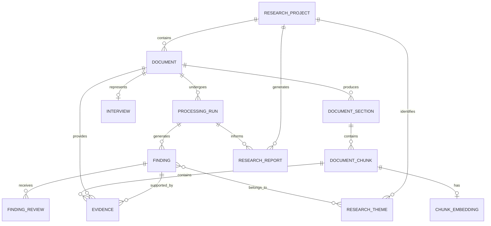

# Customer Discovery Intelligence System (CDIS)
## Database Design Document

**Document:** `database_design.md`  
**Project:** Customer Discovery Intelligence System (CDIS)  
**Version:** 1.0  
**Date:** November 2026  
**Status:** Initial database specification

---

# 1. Introduction

## 1.1 Purpose

This document defines the database architecture for the Customer Discovery Intelligence System (CDIS).

It specifies:

- The database technology.
- Core data entities.
- Entity relationships.
- Primary and foreign keys.
- Database constraints.
- Indexing strategy.
- Data lineage.
- Document and evidence storage.
- AI processing history.
- Research review history.
- Vector storage.
- Database evolution.

The objective is to create a database that supports reliable document processing, structured customer intelligence, historical research retrieval and evidence traceability.

## 1.2 Database Technology

The primary database will be **PostgreSQL**.

Supporting technologies:

| Technology | Responsibility |
|---|---|
| PostgreSQL | Relational data storage |
| SQLAlchemy | Python ORM |
| Alembic | Database schema migrations |
| pgvector | Vector embedding storage |
| PostgreSQL Full-Text Search | Keyword-based retrieval |

## 1.3 Database Design Principles

The database will follow these principles:

1. Data integrity: Use primary keys, foreign keys, constraints and appropriate data types.
2. Traceability: Every extracted finding must be traceable to its source evidence.
3. Preservation: Original documents and extracted content must not be overwritten by subsequent transformations.
4. Versioning: Preserve processing history and changes to important research findings.
5. Normalisation: Avoid unnecessary duplication of structured information.
6. Extensibility: Allow new research capabilities without redesigning the entire database.
7. Auditability: Record important processing and review operations.
8. Separation of concerns: Store document metadata, findings, evidence and processing history in appropriately separated entities.

---

# 2. Database Architecture Overview

CDIS will use a relational database organised around several related domains.

| Domain | Purpose |
|---|---|
| Project management | Organise customer research projects |
| Document management | Store document metadata and processing information |
| Interview management | Represent individual customer interviews |
| Document processing | Track extraction and transformation operations |
| Content management | Store extracted sections and chunks |
| Research intelligence | Store problems, needs and feature requests |
| Evidence management | Preserve supporting customer quotations |
| Research analysis | Store themes and consolidated findings |
| Human review | Record approval decisions and changes |
| Reporting | Track generated research reports |
| AI metadata | Record model and prompt information |
| Retrieval | Store embeddings and search information |

## 2.1 Conceptual Entity Relationship Diagram

The following diagram presents the proposed relationships.



This is a conceptual representation. The final implementation may introduce additional tables and constraints as the application evolves.

---

# 3. Core Database Entities

# 3.1 Research Projects

**Table:** `research_projects`

A research project represents a collection of related customer discovery activities.

For example, an organisation may create a project to investigate customer dissatisfaction with its payment process.

A project can contain multiple interviews, documents, findings and reports.

### Proposed columns

| Column | Data type | Constraint | Description |
|---|---|---|---|
| id | UUID | Primary key | Unique project identifier |
| name | VARCHAR(255) | NOT NULL | Project name |
| description | TEXT | NULL | Project description |
| research_objective | TEXT | NULL | Research objective |
| status | VARCHAR(30) | NOT NULL | Project status |
| created_at | TIMESTAMPTZ | NOT NULL | Creation timestamp |
| updated_at | TIMESTAMPTZ | NOT NULL | Last update timestamp |

### Example record

| Field | Example |
|---|---|
| name | Customer Payment Experience |
| description | Research into customer payment challenges |
| research_objective | Identify barriers affecting payment completion |
| status | active |

### Responsibilities

- Organise related customer research.
- Provide a common context for documents and findings.
- Support project-level reporting.
- Enable research comparisons across documents.

---

# 3.2 Documents

**Table:** `documents`

Represents an uploaded research document.

A document may be a DOCX, TXT or PDF file.

The original file should be stored in file storage, while PostgreSQL stores its metadata and storage reference.

### Proposed columns

| Column | Data type | Constraint | Description |
|---|---|---|---|
| id | UUID | Primary key | Unique document identifier |
| project_id | UUID | Foreign key, NOT NULL | Associated research project |
| filename | VARCHAR(255) | NOT NULL | Original filename |
| storage_key | TEXT | NOT NULL | Internal storage reference |
| file_type | VARCHAR(20) | NOT NULL | File format |
| mime_type | VARCHAR(100) | NULL | MIME type |
| file_size | BIGINT | NOT NULL | File size in bytes |
| checksum_sha256 | CHAR(64) | NOT NULL | Document fingerprint |
| status | VARCHAR(30) | NOT NULL | Processing status |
| uploaded_at | TIMESTAMPTZ | NOT NULL | Upload timestamp |
| research_date | DATE | NULL | Date of the research interview, if known |

### Important design decisions

**Why store a checksum?**

A checksum helps identify identical files.

For example, uploading the same interview twice should not automatically create two independent research records.

**Why store `storage_key` instead of the file itself?**

The original document should live in local or cloud file storage.

PostgreSQL should hold a reference to that file rather than becoming the default location for large binary documents.

**Why distinguish `uploaded_at` and `research_date`?**

An interview conducted in January may only be uploaded in March.

The upload date and actual research date represent different events.

### Important constraints

- A document must belong to an existing project.
- File size must be positive.
- File format must be supported.
- The checksum must be valid.
- A document should not be processed as though it were a new interview merely because it was uploaded again.

---

# 3.3 Interviews

**Table:** `interviews`

Represents an interview contained in a document.

A document may represent one interview in the initial version of CDIS.

Separating interviews from documents provides flexibility for future cases where a document contains multiple interviews or an interview is represented by multiple source files.

### Proposed columns

| Column | Data type | Constraint | Description |
|---|---|---|---|
| id | UUID | Primary key | Unique interview identifier |
| document_id | UUID | Foreign key, UNIQUE, NOT NULL | Source document |
| interview_code | VARCHAR(100) | NULL | Research interview reference |
| participant_label | VARCHAR(150) | NULL | Non-identifying participant label |
| participant_segment | VARCHAR(150) | NULL | Customer segment |
| interview_date | DATE | NULL | Interview date |
| interviewer | VARCHAR(150) | NULL | Interviewer label |
| metadata | JSONB | NULL | Additional structured metadata |
| created_at | TIMESTAMPTZ | NOT NULL | Creation timestamp |

### Example

| Field | Example |
|---|---|
| interview_code | INT-001 |
| participant_label | Participant A |
| participant_segment | Small Business |
| interview_date | 2026-10-15 |

Avoid storing unnecessary personal information about interview participants.

The system should use anonymised or pseudonymous participant labels wherever possible.

---

# 3.4 Processing Runs

**Table:** `processing_runs`

A processing run represents one execution of the document-processing or intelligence pipeline.

A document may undergo multiple processing runs.

For example:

- First extraction using parser version 1.
- Second extraction after correcting a document-processing bug.
- AI analysis using one model.
- Reprocessing using a newer model or prompt.

### Proposed columns

| Column | Data type | Constraint | Description |
|---|---|---|---|
| id | UUID | Primary key | Unique processing run |
| document_id | UUID | Foreign key, NOT NULL | Processed document |
| status | VARCHAR(30) | NOT NULL | Processing status |
| pipeline_version | VARCHAR(50) | NULL | Pipeline version |
| model_name | VARCHAR(150) | NULL | Model used |
| model_version | VARCHAR(100) | NULL | Model version |
| prompt_version | VARCHAR(100) | NULL | Prompt version |
| started_at | TIMESTAMPTZ | NOT NULL | Start timestamp |
| completed_at | TIMESTAMPTZ | NULL | Completion timestamp |
| error_message | TEXT | NULL | Failure information |
| metadata | JSONB | NULL | Additional execution metadata |

### Why is this table important?

Without processing history, it becomes difficult to understand how a finding was generated.

Suppose the system produces a customer problem using one model and then produces a different result after a model update.

Processing runs allow CDIS to preserve that distinction.

### Suggested statuses

- pending
- running
- completed
- failed
- cancelled

---

# 3.5 Document Sections

**Table:** `document_sections`

Represents meaningful structural sections extracted from a document.

Examples:

- Interview introduction.
- Background questions.
- Customer responses.
- Discussion about payment.
- Closing remarks.

### Proposed columns

| Column | Data type | Constraint | Description |
|---|---|---|---|
| id | UUID | Primary key | Unique section identifier |
| document_id | UUID | Foreign key, NOT NULL | Source document |
| section_type | VARCHAR(50) | NULL | Section classification |
| heading | TEXT | NULL | Section heading |
| content | TEXT | NOT NULL | Extracted section content |
| sequence_number | INTEGER | NOT NULL | Position in document |
| source_location | JSONB | NULL | Source position metadata |
| created_at | TIMESTAMPTZ | NOT NULL | Creation timestamp |

### Important considerations

Preserve document order.

The order of questions and responses can influence how a statement should be interpreted.

For example, a customer response should not be separated from the question that gives it context.

---

# 3.6 Document Chunks

**Table:** `document_chunks`

Represents smaller portions of document content prepared for AI processing and retrieval.

A section may produce several chunks.

### Proposed columns

| Column | Data type | Constraint | Description |
|---|---|---|---|
| id | UUID | Primary key | Unique chunk identifier |
| document_id | UUID | Foreign key, NOT NULL | Source document |
| section_id | UUID | Foreign key, NULL | Parent section |
| chunk_index | INTEGER | NOT NULL | Chunk position |
| content | TEXT | NOT NULL | Chunk text |
| content_hash | CHAR(64) | NOT NULL | Chunk fingerprint |
| token_count | INTEGER | NULL | Approximate token count |
| start_offset | INTEGER | NULL | Starting text offset |
| end_offset | INTEGER | NULL | Ending text offset |
| metadata | JSONB | NULL | Speaker and source metadata |
| created_at | TIMESTAMPTZ | NOT NULL | Creation timestamp |

### Why store chunks separately?

A complete interview may contain thousands of words.

Sending the entire interview to an LLM for every task can be inefficient and may exceed the model's context window.

Chunks allow the system to process and retrieve relevant portions of research.

### Chunk metadata

Where possible, preserve:

- Speaker.
- Section.
- Paragraph reference.
- Source position.
- Document identifier.
- Chunking strategy version.

Do not treat chunks as independent source documents.

They must always remain traceable to the original document.

---

# 4. Research Intelligence Entities

# 4.1 Findings

**Table:** `findings`

A finding represents an extracted customer insight.

Examples:

- Customer problem.
- Customer need.
- Feature request.

Findings are stored independently from their supporting evidence.

This is important because a finding may have multiple supporting quotations.

### Proposed columns

| Column | Data type | Constraint | Description |
|---|---|---|---|
| id | UUID | Primary key | Unique finding identifier |
| project_id | UUID | Foreign key, NOT NULL | Associated research project |
| processing_run_id | UUID | Foreign key, NOT NULL | Processing run that generated it |
| finding_type | VARCHAR(40) | NOT NULL | Finding category |
| title | VARCHAR(255) | NOT NULL | Short finding title |
| description | TEXT | NOT NULL | Finding description |
| interpretation | TEXT | NULL | System interpretation |
| confidence | VARCHAR(20) | NULL | Confidence classification |
| review_status | VARCHAR(30) | NOT NULL | Review status |
| created_at | TIMESTAMPTZ | NOT NULL | Creation timestamp |
| updated_at | TIMESTAMPTZ | NOT NULL | Last update timestamp |

### Finding types

- `customer_problem`
- `customer_need`
- `feature_request`

Additional categories can be introduced when justified by product requirements.

### Review statuses

- `pending_review`
- `approved`
- `rejected`
- `needs_revision`

### Important design decision

Do not store the complete supporting quotation as the only evidence field inside the finding.

Evidence should be stored in its own table.

This allows one finding to have several supporting quotations from different interviews.

---

# 4.2 Evidence

**Table:** `evidence`

Evidence represents the original customer statements supporting a finding.

This is one of the most important tables in the CDIS database.

### Proposed columns

| Column | Data type | Constraint | Description |
|---|---|---|---|
| id | UUID | Primary key | Unique evidence identifier |
| finding_id | UUID | Foreign key, NOT NULL | Associated finding |
| document_id | UUID | Foreign key, NOT NULL | Original source document |
| chunk_id | UUID | Foreign key, NULL | Source chunk |
| quote | TEXT | NOT NULL | Exact supporting quotation |
| source_location | JSONB | NULL | Paragraph, page or location |
| start_offset | INTEGER | NULL | Starting text position |
| end_offset | INTEGER | NULL | Ending text position |
| verification_status | VARCHAR(30) | NOT NULL | Evidence verification status |
| created_at | TIMESTAMPTZ | NOT NULL | Creation timestamp |

### Example

A customer states:

> "I never know when my order will arrive."

CDIS may identify the following:

**Finding**

Customers struggle to track order progress.

**Interpretation**

Customers lack visibility into order status.

**Evidence**

"I never know when my order will arrive."

The evidence record points to the original document and source location.

### Evidence verification statuses

- `pending`
- `verified`
- `unverified`
- `rejected`

### Evidence integrity rules

1. Evidence must reference an existing finding.
2. Evidence must reference an existing source document.
3. The quotation should be checked against the original source.
4. Source locations should be preserved where available.
5. An unverified quotation must not be presented as verified evidence.

A finding without sufficient supporting evidence should remain explicitly unsubstantiated or be flagged for review.

---

# 4.3 Research Themes

**Table:** `research_themes`

Represents recurring topics or patterns identified across customer interviews.

Examples:

- Payment friction.
- Delivery uncertainty.
- Poor customer support.
- Pricing transparency.

### Proposed columns

| Column | Data type | Constraint | Description |
|---|---|---|---|
| id | UUID | Primary key | Unique theme identifier |
| project_id | UUID | Foreign key, NOT NULL | Associated research project |
| name | VARCHAR(255) | NOT NULL | Theme name |
| description | TEXT | NULL | Theme explanation |
| status | VARCHAR(30) | NOT NULL | Theme status |
| created_at | TIMESTAMPTZ | NOT NULL | Creation timestamp |
| updated_at | TIMESTAMPTZ | NOT NULL | Last update timestamp |

## 4.4 Finding Themes

**Table:** `finding_themes`

This is a junction table connecting findings to research themes.

It represents a many-to-many relationship.

A finding may belong to multiple themes, and a theme may contain multiple findings.

### Proposed columns

| Column | Data type | Constraint | Description |
|---|---|---|---|
| finding_id | UUID | Composite primary key, foreign key | Associated finding |
| theme_id | UUID | Composite primary key, foreign key | Associated theme |
| created_at | TIMESTAMPTZ | NOT NULL | Relationship creation timestamp |

This design avoids duplicating theme information inside every finding.

---

# 5. Human Review and Version History

# 5.1 Finding Reviews

**Table:** `finding_reviews`

Records human review actions.

### Proposed columns

| Column | Data type | Constraint | Description |
|---|---|---|---|
| id | UUID | Primary key | Unique review identifier |
| finding_id | UUID | Foreign key, NOT NULL | Reviewed finding |
| reviewer_id | UUID | NULL initially | Reviewer identifier |
| decision | VARCHAR(30) | NOT NULL | Review decision |
| comments | TEXT | NULL | Review comments |
| reviewed_at | TIMESTAMPTZ | NOT NULL | Review timestamp |

### Possible decisions

- approved
- rejected
- needs_revision

Each review action should create a separate record.

Do not overwrite earlier review decisions.

## 5.2 Finding Versions

**Table:** `finding_versions`

Preserves previous versions of findings when their descriptions or interpretations are changed.

### Proposed columns

| Column | Data type | Constraint | Description |
|---|---|---|---|
| id | UUID | Primary key | Unique version identifier |
| finding_id | UUID | Foreign key, NOT NULL | Original finding |
| version_number | INTEGER | NOT NULL | Version number |
| title | VARCHAR(255) | NOT NULL | Versioned title |
| description | TEXT | NOT NULL | Versioned description |
| interpretation | TEXT | NULL | Versioned interpretation |
| changed_by | UUID | NULL | User responsible |
| change_reason | TEXT | NULL | Reason for change |
| created_at | TIMESTAMPTZ | NOT NULL | Version creation time |

A unique constraint should exist on:

`(finding_id, version_number)`

### Why preserve versions?

Suppose the AI initially identifies a finding as:

"Customers have problems with payments."

A human reviewer later changes it to:

"Customers experience failed payment attempts when using mobile money."

The system should preserve the original result and the human-reviewed version.

This is important for auditability and AI evaluation.

---

# 6. Reporting Entities

# 6.1 Research Reports

**Table:** `research_reports`

Represents generated research reports.

### Proposed columns

| Column | Data type | Constraint | Description |
|---|---|---|---|
| id | UUID | Primary key | Unique report identifier |
| project_id | UUID | Foreign key, NOT NULL | Associated project |
| processing_run_id | UUID | Foreign key, NULL | Source processing run where applicable |
| report_name | VARCHAR(255) | NOT NULL | Report name |
| storage_key | TEXT | NOT NULL | File storage reference |
| file_type | VARCHAR(20) | NOT NULL | Report format |
| status | VARCHAR(30) | NOT NULL | Generation status |
| generated_at | TIMESTAMPTZ | NOT NULL | Generation timestamp |
| generated_by | UUID | NULL | User identifier |

### Suggested report statuses

- pending
- generating
- completed
- failed

### Important consideration

A report should represent a particular research state.

If findings change after a report has been generated, the existing report should not silently change.

Generate a new report version when updated research needs to be reflected.

---

# 7. AI and Retrieval Entities

# 7.1 Model and Prompt Metadata

Model and prompt information must be preserved for reproducibility.

Initially, this information can be recorded in processing run metadata.

As AI capabilities expand, dedicated tables can be introduced for:

- Model configurations.
- Prompt templates.
- Prompt versions.
- Evaluation runs.

Do not create unnecessary configuration tables before the application requires them.

# 7.2 Chunk Embeddings

**Table:** `chunk_embeddings`

Stores vector representations of document chunks.

### Proposed columns

| Column | Data type | Constraint | Description |
|---|---|---|---|
| id | UUID | Primary key | Unique embedding record |
| chunk_id | UUID | Foreign key, NOT NULL | Associated document chunk |
| embedding_model | VARCHAR(150) | NOT NULL | Embedding model |
| embedding_version | VARCHAR(100) | NULL | Model version |
| embedding | VECTOR | NOT NULL | Numerical vector |
| created_at | TIMESTAMPTZ | NOT NULL | Generation timestamp |

The `VECTOR` type is provided by pgvector.

### Important considerations

- Embeddings must be associated with their source chunks.
- Different embedding models may produce different vector dimensions.
- Vector indexes must be configured consistently with embedding dimensions.
- Embeddings should be regenerated when the embedding model or relevant preprocessing strategy changes.
- Do not compare embeddings from incompatible models as though they share the same vector space.

### Why not store embeddings directly in document chunks?

Separating embeddings allows the same chunk to have multiple embeddings generated by different models or versions.

This is useful for controlled model comparisons.

---

# 8. Relationship Summary

The following table summarises the main relationships.

| Parent entity | Child entity | Relationship | Explanation |
|---|---|---|---|
| Research Project | Document | One-to-many | A project contains multiple documents |
| Document | Interview | One-to-one initially | A document represents one interview |
| Document | Processing Run | One-to-many | A document can be processed repeatedly |
| Document | Document Section | One-to-many | A document contains multiple sections |
| Document Section | Document Chunk | One-to-many | A section can contain multiple chunks |
| Document | Document Chunk | One-to-many | A document produces multiple chunks |
| Processing Run | Finding | One-to-many | A run can generate multiple findings |
| Finding | Evidence | One-to-many | A finding can have multiple quotations |
| Document | Evidence | One-to-many | A document can support multiple findings |
| Finding | Research Theme | Many-to-many | Findings can belong to multiple themes |
| Research Project | Research Theme | One-to-many | Themes belong to a project |
| Finding | Finding Review | One-to-many | A finding can have multiple reviews |
| Finding | Finding Version | One-to-many | A finding can have multiple versions |
| Research Project | Research Report | One-to-many | A project can generate multiple reports |
| Document Chunk | Chunk Embedding | One-to-many conceptually | A chunk can have multiple model-specific embeddings |

---

# 9. Primary Keys and Foreign Keys

## 9.1 Primary Keys

All main entities will use UUID primary keys.

Examples:

- `research_projects.id`
- `documents.id`
- `findings.id`
- `evidence.id`

UUIDs provide unique identifiers without relying on sequential database IDs.

They are useful when records are created across different components or services in the future.

## 9.2 Foreign Keys

Foreign keys enforce relationships between records.

For example:

`documents.project_id` references `research_projects.id`.

This means a document cannot reference a research project that does not exist.

## 9.3 Referential Integrity

Use appropriate foreign key deletion behaviour.

Recommended initial approach:

- Prevent deletion of a project that still contains important research records.
- Avoid cascading deletion of evidence or approved findings.
- Use controlled archival or soft deletion for important records.
- Apply cascading deletion only to dependent records where permanent deletion is explicitly intended and safe.

Original documents and their research lineage should not disappear accidentally because a parent record was deleted.

---

# 10. Database Constraints and Validation

Database constraints protect data integrity even when application-level validation fails.

## 10.1 NOT NULL Constraints

Use `NOT NULL` for fields that must always exist.

Examples:

- Project name.
- Document filename.
- Document storage key.
- Finding type.
- Finding description.
- Evidence quotation.

## 10.2 UNIQUE Constraints

Examples:

- Unique project identifier.
- Unique document identifier.
- Unique document checksum within an appropriate project or deduplication scope.
- Unique interview document association.
- Unique finding version number within a finding.
- Unique finding-theme relationship.

The document checksum policy should be decided carefully: the same file may legitimately be referenced in different research contexts.

## 10.3 CHECK Constraints

Examples:

- File size must be positive.
- Sequence numbers must not be negative.
- Start offsets must not exceed end offsets.
- Status fields must contain valid values.

For important status fields, use database constraints or carefully managed enumerations rather than allowing arbitrary strings.

## 10.4 Application-Level Validation

Pydantic will validate incoming application data.

However, Pydantic validation does not replace database constraints.

Both are necessary:

- Pydantic protects application boundaries.
- Database constraints protect stored data integrity.

---

# 11. Indexing Strategy

Indexes improve query performance but consume storage and add overhead to writes.

CDIS should introduce indexes based on actual access patterns.

## 11.1 Initial Indexes

| Table | Column(s) | Purpose |
|---|---|---|
| documents | project_id | Retrieve project documents |
| documents | checksum_sha256 | Find duplicate files |
| processing_runs | document_id | Retrieve processing history |
| processing_runs | status | Find pending or failed runs |
| document_sections | document_id, sequence_number | Retrieve sections in order |
| document_chunks | document_id, chunk_index | Retrieve chunks in order |
| findings | project_id | Retrieve project findings |
| findings | finding_type | Filter by finding category |
| findings | review_status | Retrieve findings awaiting review |
| evidence | finding_id | Retrieve evidence for a finding |
| evidence | document_id | Retrieve evidence by source |
| research_themes | project_id | Retrieve project themes |
| finding_reviews | finding_id | Retrieve review history |
| research_reports | project_id | Retrieve project reports |

## 11.2 Vector Indexes

When pgvector is introduced, evaluate appropriate indexes for similarity search.

Possible index types include:

- HNSW.
- IVFFlat.

The choice should depend on dataset size, retrieval latency and recall requirements.

For a small initial dataset, exact vector search may be sufficient.

## 11.3 Full-Text Search

PostgreSQL full-text search can be introduced for:

- Document chunks.
- Finding descriptions.
- Research themes.

A generated `tsvector` column and an appropriate index can support efficient lexical search.

---

# 12. Data Lineage and Traceability

Data lineage is one of the most important aspects of CDIS.

The database should preserve the relationships between original source information and generated intelligence.

## 12.1 Lineage Chain

The intended lineage is:

```text
Original Document
       |
       v
Extracted Sections
       |
       v
Document Chunks
       |
       v
Processing Run
       |
       v
Generated Finding
       |
       v
Supporting Evidence
       |
       v
Human Review
       |
       v
Approved Research Intelligence
       |
       v
Generated Report
```

## 12.2 Traceability Requirements

For every finding, CDIS should be able to answer:

1. Which research project does it belong to?
2. Which document supplied the information?
3. Which processing run generated it?
4. Which model and prompt were used?
5. Which customer quotation supports it?
6. Where can the quotation be found in the original document?
7. Has the quotation been verified?
8. Has a human reviewed the finding?
9. Has the finding been modified?
10. Which reports include the finding?

If the system cannot answer these questions, its research traceability is incomplete.

---

# 13. Data Lifecycle

## 13.1 Document Lifecycle

A document moves through the following conceptual lifecycle:

1. Uploaded.
2. Validated.
3. Stored.
4. Extracted.
5. Normalised.
6. Quality checked.
7. Chunked.
8. Analysed.
9. Reviewed.
10. Available for research retrieval.

A document may also enter a failed or rejected state.

## 13.2 Finding Lifecycle

A finding moves through the following conceptual lifecycle:

1. Generated.
2. Structured.
3. Evidence checked.
4. Saved.
5. Awaiting review.
6. Approved, rejected or returned for revision.
7. Included in research synthesis where appropriate.
8. Included in reports where appropriate.

## 13.3 Data Retention

CDIS should eventually implement explicit retention policies.

These should define:

- How long original documents are retained.
- How processing history is retained.
- How rejected findings are retained.
- How generated reports are retained.
- How deletion requests are handled.
- How backups are managed.

Retention policies must consider organisational requirements and applicable data protection obligations.

---

# 14. Database Implementation Strategy

The entire schema should not be implemented at once.

Introduce tables as their functionality becomes necessary.

## Phase 1: Initial MVP

Implement:

- `research_projects`
- `documents`
- `processing_runs`
- `findings`
- `evidence`

These support the initial document-to-insight workflow.

## Phase 2: Document Structure

Introduce:

- `interviews`
- `document_sections`
- `document_chunks`

These support more reliable document processing and source preservation.

## Phase 3: Research Intelligence

Introduce:

- `research_themes`
- `finding_themes`

These support cross-interview research analysis.

## Phase 4: Human Review

Introduce:

- `finding_reviews`
- `finding_versions`

These support human approval and auditability.

## Phase 5: Retrieval

Introduce:

- `chunk_embeddings`
- Full-text search structures.

These support RAG and historical research retrieval.

## Phase 6: Reporting

Introduce:

- `research_reports`

These support generated report management.

Additional user, organisation, permission and authentication tables will be introduced when multi-user access is implemented.

---

# 15. Important Design Decisions

| Decision | Initial choice | Reason |
|---|---|---|
| Primary database | PostgreSQL | Strong relational database capabilities |
| Primary keys | UUID | Globally unique identifiers |
| ORM | SQLAlchemy | Structured Python database access |
| Migrations | Alembic | Version-controlled schema evolution |
| Document storage | File/object storage | Avoid storing large binary documents in relational tables by default |
| Document metadata | PostgreSQL | Structured document management |
| Findings and evidence | Separate tables | Support multiple quotations per finding |
| Processing history | Processing runs table | Preserve AI and pipeline execution history |
| Research themes | Separate entity | Support theme reuse across findings |
| Review history | Separate table | Preserve human decisions |
| Vector storage | pgvector | Integrate retrieval with PostgreSQL |
| Additional metadata | JSONB selectively | Support flexible metadata without weakening core relational structure |

---

# 16. Risks and Considerations

## 16.1 Loss of Evidence Traceability

**Risk:** Findings become disconnected from their original quotations.

**Mitigation:** Enforce evidence relationships and source references.

## 16.2 Duplicate Research Documents

**Risk:** Repeated uploads create duplicate research records.

**Mitigation:** Use SHA-256 checksums and a deliberate deduplication policy.

## 16.3 Uncontrolled Schema Changes

**Risk:** Application changes break existing records.

**Mitigation:** Use Alembic migrations and test schema changes.

## 16.4 Excessive JSONB Usage

**Risk:** Important structured information becomes difficult to validate and query.

**Mitigation:** Use relational columns for core entities and JSONB only for genuinely flexible metadata.

## 16.5 Incompatible Embeddings

**Risk:** Embeddings from different models are compared incorrectly.

**Mitigation:** Preserve model identity and embedding dimensions.

## 16.6 Destructive Updates

**Risk:** Human edits overwrite the original AI-generated result.

**Mitigation:** Preserve finding versions and review history.

## 16.7 Uncontrolled Deletion

**Risk:** Deleting a document or project removes important research evidence.

**Mitigation:** Use controlled archival and explicit deletion policies.

---

# 17. Final Database Objective

The CDIS database must support more than simply storing uploaded documents and AI-generated text.

It must preserve the relationships between:

- Research projects.
- Original customer interviews.
- Extracted document content.
- Processing operations.
- AI-generated findings.
- Customer quotations.
- Research themes.
- Human review decisions.
- Generated reports.

The database should make it possible to trace every important conclusion back to the evidence that supports it.

**The central database design principle is that customer intelligence must remain structured, attributable, reproducible and auditable throughout its lifecycle.**

**End of Document.**
